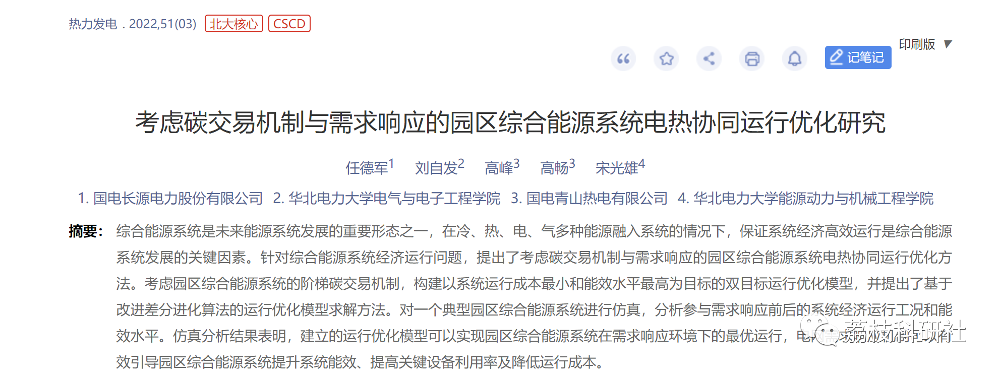
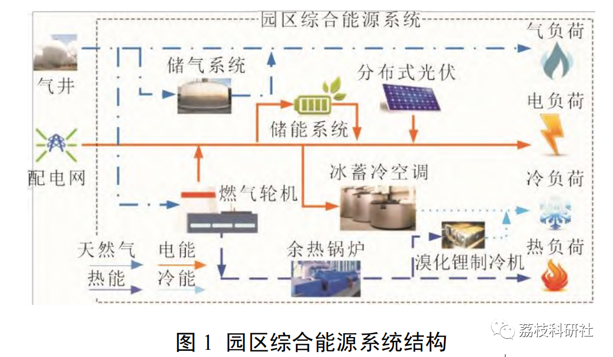
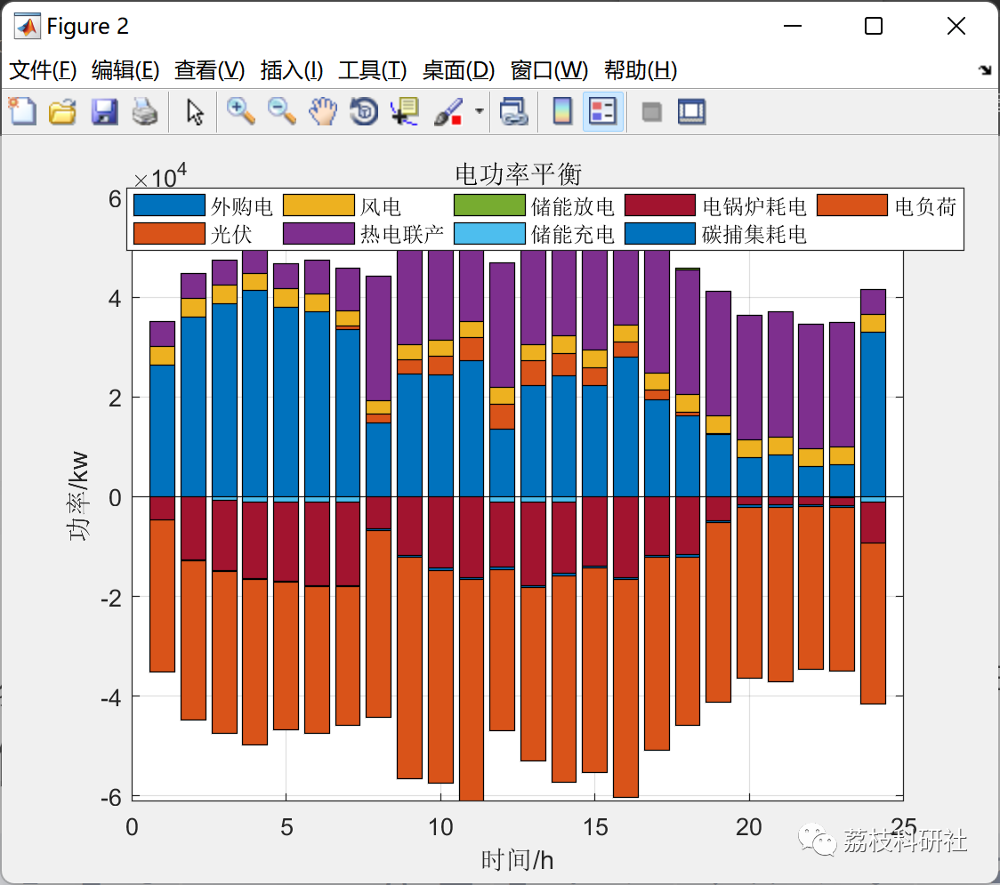
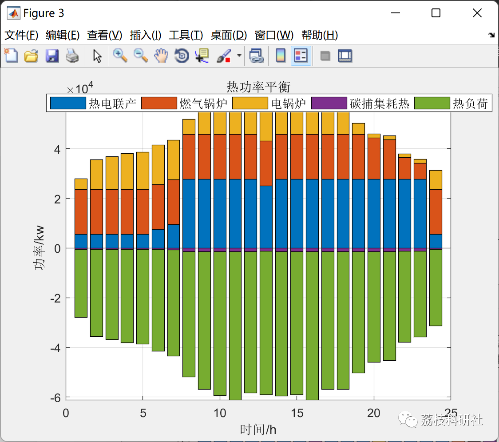
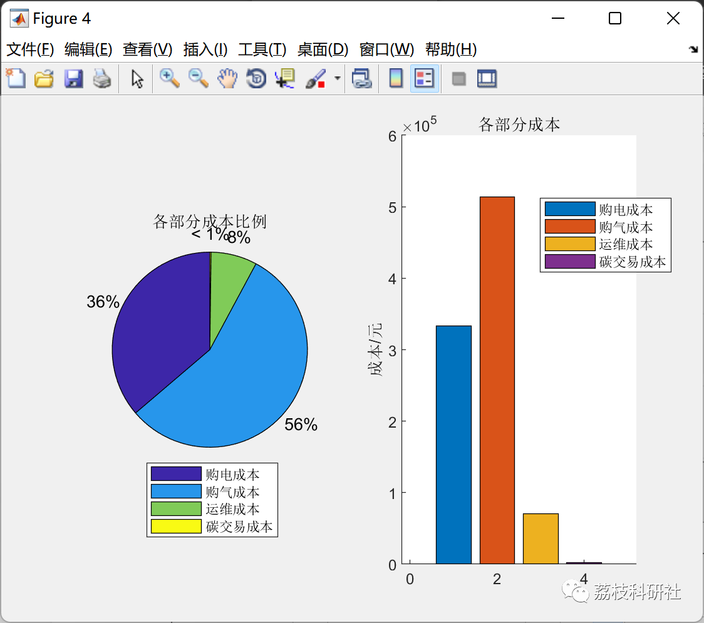
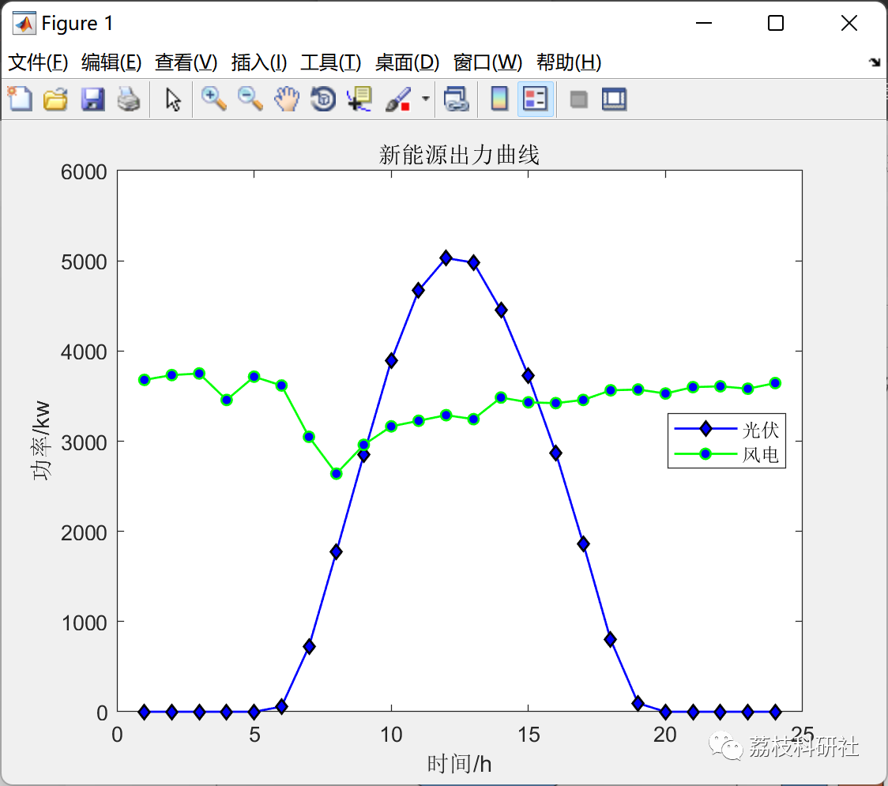

# Optimization Research on the Coordinated Operation of Thermal and Electricity in a Park Comprehensive Energy System Considering Carbon Trading Mechanism (Matlab Code Implementation)

💥💥💥💞💞💞 Welcome to this blog❤️❤️❤️ 💥💥💥
🏆 Bloggers' Advantages: 🌞🌞🌞 The content of the blog strives for rigorous thinking and clear logic to facilitate readers.
⛳️ Mantra: A journey of a thousand miles is begun with a single step.
Litchi Research Society
Code Collection: Power Systems, Intelligent Algorithms and Applications, Neural Network Prediction, Path Planning, Optimized Scheduling, Workshop Scheduling, Image Processing, Signal Processing...
🎁 Special Section Links:
🌈🌈🌈🌟🌟🌟 Electrical Code Drone and Physical Application Path Planning Intelligent Algorithms and Their Applications Optimized Scheduling Neural Network Prediction Workshop Scheduling Image Processing Romantic Her Signal Processing Mathematical Modelling My Thoughts Voice Processing Complete Code Issues
💥1 References
📚2 Overview
Park Integrated Energy System (PIES) based on its user's demand for cooling, heating, electricity, and gas in the area, configures various energy conversion devices to couple multiple forms of energy, has a complex energy structure. Due to the diversity of load demand in the park integrated energy system, power demand response gradually expands into comprehensive demand response for electricity, gas, cooling, and heating.
Typical structure of park integrated energy system is shown in Figure 1, which is connected to the distribution network and gas network, can buy gas and electricity from the distribution network and sell electricity to the grid. The energy supply of the park integrated energy system not only comes directly from the distribution network and gas network but also installs a large number of photovoltaic panels to meet part of the energy supply of the park by using renewable energy generation, reducing carbon emissions while lowering the cost of purchasing energy. The energy conversion equipment of the park integrated energy system includes typical combined heat and power units consisting of gas turbine and waste heat boiler; energy storage equipment includes electric energy storage, thermal storage tanks and gas storage tanks; load includes electrical load, gas load, thermal load and cooling load.
🎉3 Operation Results
👨‍💻4 Matlab Code
Click the article below left bottom [Read Full Content]

## Images

<!-- PAYMENT_BLOCK -->

## Get this dataset

- Payment link (Stripe): [Buy now](https://buy.stripe.com/3cs8yP7sY87d0vu9AB)
- Payment QR code: 

<!-- /PAYMENT_BLOCK -->
